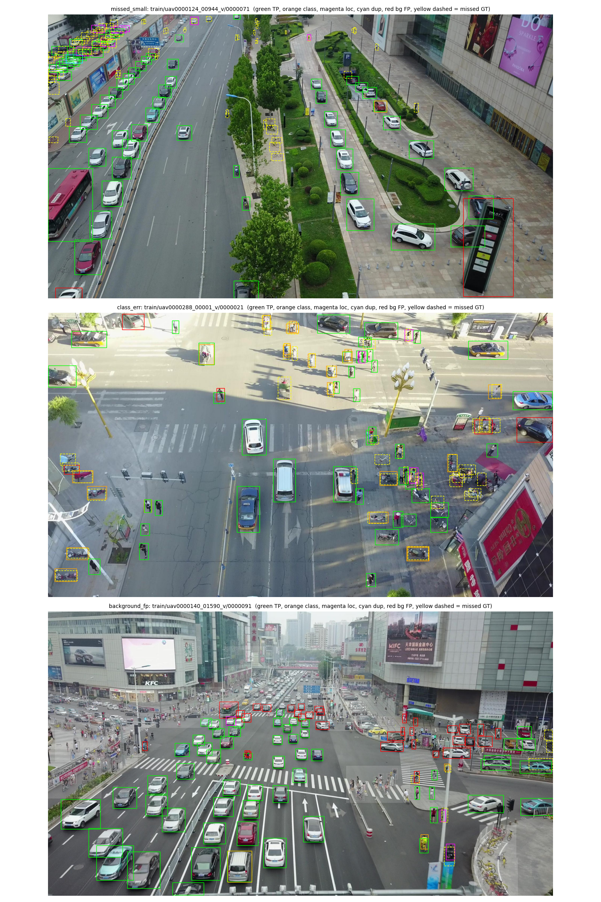
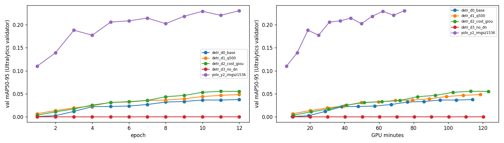

**Kaggle public leaderboard:** 0.2789 (best) · **private leaderboard:** available after the competition closes

## 1 Methodology and motivation

### 1.1 Problem statement

Detecting objects in drone video is hard not because of the detector alone but because of the data: objects are small, scenes dense, large areas ignored, and test frames differ in resolution from training frames. We compare four detector families under one protocol, improve the best ones through data, inference and ensembling, and quantify each change by COCO mAP. Run keys in the tables match `results/` and the notebooks.

### 1.2 Data preparation and EDA

The data contain 63 labelled clips (27,047 frames, 1.22 M boxes) and 48 test clips (3,811 frames). The EDA identifies five properties that determine the later decisions:

1. **Small objects:** median box side 46 px, 24 % COCO-small. At a 640-px long side 54 % of boxes fall below 16 px, at 1280 10 %, at 1536 5 %; we train at 1280 and test 1536.
2. **Imbalance:** car 44 %, person 31 %, bus 0.8 %; per-class AP is tracked.
3. **Density:** median 42, p99 140, max 180 objects per frame (500 detections kept); only 3.5 % of boxes overlap a neighbour at IoU > 0.5.
4. **Ignored regions** in 72 % of frames (1.7 % of the area). The COCO json stores each region 8× (once per class); we keep one copy, grey-fill it in training images and re-create per-class crowd boxes in the evaluator.
5. **Resolution shift:** training frames reach 2688–3840 px, test frames ≤ 1920 px (16 % at 680–960 px), which motivates scale augmentation.

### 1.3 Validation design

All experiments share one protocol, which makes their results directly comparable:

1. **Folds:** `GroupKFold(5)` over clips; fold 0 (12 clips, 545 frames) is the fixed holdout; numbers come from the last epoch, so the holdout is never used for selection.
2. **Subsampling:** the same object keeps IoU 0.90 after 1 frame but 0.35 after 10, so every 10th frame is used (2,189 training frames).
3. **Metric:** COCO mAP@[.5:.95], 500 detections, ignored regions as crowd; GT as predictions gives AP 1.0, and a ±2 px shift lowers AP_small to 0.66.
4. **Setup:** long side 1280, horizontal flip only, 12 epochs, seed 42, two runs in parallel on 2×T4.

### 1.4 Models and tuning strategy

Each family starts from COCO-pretrained weights and is changed one parameter at a time. Notebook 06 separates **Part B** (training data, fixed inference) from **Part A** (inference and ensembling, fixed models); WBF is implemented from the paper (`src/infer.py`).

## 2 Results and analysis

### 2.1 Two-stage anchor-based: Faster R-CNN

**Table 1:** Faster R-CNN on fold 0 (ms/img: batch-1 latency on a T4)

| Run | Change | AP | AP50 | AP75 | AP_small | ms/img | Public LB |
|---|---|---|---|---|---|---|---|
| `frcnn_e0_base` | default (1000 test proposals) | 0.249 | 0.465 | 0.232 | 0.106 | 65 | — |
| `frcnn_e1_proposals` | 3000 RPN proposals | **0.256** | **0.480** | **0.244** | 0.109 | 114 | 0.212 |
| `frcnn_e2_giou` | E1 + GIoU loss (weight 10) | 0.251 | 0.472 | 0.227 | 0.111 | 106 | — |
| `frcnn_e3_roi_sampling` | E1 + 1024 RoIs, 50 % positives | 0.247 | 0.458 | 0.231 | 0.112 | 114 | — |
| `frcnn_e4_cosine` | E2 + cosine schedule | 0.243 | 0.455 | 0.226 | 0.104 | 107 | — |

**Proposals.** 3000 instead of 1000 proposals give +0.7 AP (truck 0.074 → 0.151) at 1.8× latency. **Box loss.** GIoU lowers AP75 (0.244 → 0.227); the weight of 10 likely lets the box term dominate. AP fluctuates by ±1 pt between epochs and plateaus after ~3 epochs (`images/frcnn_curves.png`), so differences below 1 pt lie within noise.

**What each stage contributes.** The RPN reaches 61 % recall (IoU ≥ 0.5) on small objects with 1000 proposals and 62 % with 3000 (88–90 % medium, 98–100 % large). After the second stage (score ≥ 0.05) small-object recall falls to 43 %, while medium and large lose 10 and 3 points. The bottleneck for small objects is therefore classification of tiny RoIs, not proposal coverage.

**Failure cases** (score ≥ 0.3: 55 % TP, 18 % in ignored regions, 12 % background, 7 % class, 7 % localisation; Figure 1). (1) *Missed small objects* under trees and far away; recall falls from 70 % to 30 % with heavy occlusion. (2) *Class confusion*: bicycle ↔ motor, van ↔ car. (3) *Background FPs*: mostly unannotated objects near the horizon.

**Figure 1:** Faster R-CNN E1 failure cases (green TP, orange class error, magenta localisation, red background FP, yellow dashed missed GT).

### 2.2 One-stage anchor-based: RetinaNet

**Table 2:** RetinaNet on fold 0 (R0 latency: 51 ms/img)

| Run | Change | AP | AP50 | AP_small | AP_medium | AP_large | Public LB |
|---|---|---|---|---|---|---|---|
| `retina_r0_base` | default anchors 32–512, focal γ = 2, IoU 0.5 / 0.4 | **0.230** | **0.422** | **0.076** | **0.174** | **0.436** | 0.196 |
| `retina_r1_anchors` | anchors 8–128 px, ratios 0.5 / 1 / 2 | 0.146 | 0.357 | 0.069 | 0.114 | 0.235 | — |
| `retina_r2_iou` | R1 + IoU thresholds 0.4 / 0.3 | 0.162 | 0.383 | 0.073 | 0.123 | 0.261 | — |
| `retina_r3_focal` | R2 + focal γ = 1.5 | 0.161 | 0.388 | 0.073 | 0.126 | 0.259 | — |
| `retina_r4_l1` | R2 + L1 instead of GIoU | 0.162 | 0.392 | 0.072 | 0.131 | 0.260 | — |

**Anchors.** Fitted on the training folds, 8–128-px anchors raise shape coverage (IoU ≥ 0.5) from 0.718 to 0.999, yet AP falls by 8.5 points, mostly on large objects (0.436 → 0.235): the largest anchor shrinks from ~800 to ~200 px, while small objects do not gain. Coverage of typical boxes is not sufficient; the range must still cover the largest ones. Lower IoU thresholds recover 1.7 points; focal γ and box loss change AP by < 0.2.

**Removing the proposal stage** leaves ~10⁵ anchors with a few hundred positives; focal loss handles this imbalance, but without RoI re-pooling boxes are less precise (AP75 0.219 vs 0.244). R0 is 2.6 AP below Faster R-CNN but 2.2× faster.

### 2.3 One-stage anchor-free: YOLOv8

**Assignment without anchors.** YOLOv8 predicts box-edge distances at every grid cell; the Task-Aligned Assigner keeps the top-k cells inside a GT box by score^α · IoU^β, so a tiny box gets positives only from the few cells inside it, and dense neighbours compete for them. A P2 head quadruples these cells.

**Table 3:** YOLOv8 on fold 0, broken down by object size

| Run | Change | AP | AP50 | AP_small | AP_medium | AP_large | ms/img | Public LB |
|---|---|---|---|---|---|---|---|---|
| `yolo_y0_base` | yolov8s, 1280 | 0.203 | 0.365 | **0.096** | 0.153 | **0.350** | 23 | — |
| `yolo_y1_p2` | + P2 head | 0.199 | 0.379 | 0.081 | 0.160 | **0.350** | 26 | — |
| `yolo_y2_imgsz1024` | P2, 1024 | 0.172 | 0.333 | 0.071 | 0.129 | 0.318 | 20 | — |
| `yolo_y2_imgsz1536` | P2, 1536 | **0.210** | **0.405** | 0.093 | **0.177** | 0.325 | 31 | 0.141 |
| `yolo_y3_tal13` | P2, TAL top-k 13 | 0.194 | 0.375 | 0.088 | 0.152 | 0.339 | 21 | — |

**Resolution** matters most (1024 → 1536: +3.8 AP). **P2** lowers AP_small: all P2 models start from random P2 layers at 0.10 mAP and are still improving at epoch 12, i.e. not converged. Without augmentation YOLOv8s is below both anchor-based detectors on every size bucket but 4–5× faster (`images/ap_by_size_anchor_free.png`).

### 2.4 Query-based: RT-DETR

**Bipartite matching.** Each query predicts one box or "no object"; the Hungarian algorithm assigns each GT to exactly one query, so duplicates are penalised by the loss and NMS is not needed, but early assignments are unstable; denoising queries stabilise them.

**Table 4:** RT-DETR-l on fold 0

| Run | Change | AP | AP50 | AP_small | AR | ms/img |
|---|---|---|---|---|---|---|
| `detr_d0_base` | 300 queries | 0.033 | 0.077 | 0.032 | 0.132 | 88 |
| `detr_d1_q500` | 500 queries | 0.044 | 0.086 | 0.031 | 0.210 | 87 |
| `detr_d2_cost_giou` | D1 + GIoU matching weight 2 → 4 | **0.056** | **0.101** | 0.031 | **0.240** | 87 |
| `detr_d3_no_dn` | D1 without denoising | 0.000 | 0.000 | 0.000 | 0.002 | 90 |

**RT-DETR has not converged within the budget.** In 12 epochs YOLOv8 reaches 0.23 mAP while every RT-DETR run is still rising at 0.04–0.06 (Figure 2). Without denoising (D3) AP stays at zero: unstable matching gives no learning signal. 500 queries help despite p99 = 140 objects because they raise recall of an unconverged model (AR 0.13 → 0.21); a larger GIoU matching weight adds +1.2 AP.

**Dense scenes.** Splitting holdout frames into density tertiles, small-object AP of the CNNs drops from sparse to dense frames (Faster R-CNN 0.146 → 0.058, YOLO 0.119 → 0.063); RT-DETR stays near 0.03 everywhere.

**Figure 2:** Validation mAP per epoch (left) and per GPU minute (right): RT-DETR D0–D3 vs YOLOv8 Y2-1536.

### 2.5 Final pipeline: data, inference and ensembling

**Part B — training data, fixed inference.** Y0 is the base, since three runs at 1536 + P2 did not fit the 12-hour session.

**Table 5:** Part B (YOLOv8s, fold 0)

| Run | Change | AP | AP50 | AP_small | ms/img |
|---|---|---|---|---|---|
| `yolo_y0_base` | flip only, step 10, 12 epochs | 0.203 | 0.365 | 0.096 | 23 |
| `final_b1_step5` | step 5 (2× frames) | 0.193 | 0.346 | 0.072 | 24 |
| `final_b2_fullaug` | mosaic, scale 0.5, translate, HSV | **0.237** | **0.429** | **0.115** | 18 |
| `final_b3_24ep` | 24 epochs | 0.192 | 0.348 | 0.093 | 19 |

Denser sampling and longer training add steps on the same scenes and overfit (Y0 peaked at epoch 8). Augmentation removes this and, through scale jitter, covers the smaller test frames: B2 (+3.4 AP) is the best YOLO, better than Y2-1536 at half the latency.

**Part A — inference and ensembling with fixed models.**

**Table 6:** Inference strategies and ensembles (fold 0)

| Strategy | AP | AP50 | AP_small | Public LB |
|---|---|---|---|---|
| B2, plain (NMS IoU 0.6) | 0.237 | 0.429 | 0.115 | — |
| B2, NMS IoU 0.5 / 0.7 | 0.235 / 0.238 | 0.427 / 0.428 | 0.115 / 0.115 | — |
| B2, TTA (flips + scales) | 0.251 | 0.454 | 0.115 | — |
| B2, sliced (tiles 640 / 960 + full frame) | 0.236 / 0.246 | 0.434 / 0.454 | 0.119 / **0.142** | — |
| WBF B2 + Faster R-CNN E1, weights 1 : 1 | 0.282 | 0.514 | 0.128 | **0.279** |
| WBF B2 + Faster R-CNN E1, weights 1 : 2 | 0.275 | 0.503 | 0.121 | — |
| WBF B2 + Faster R-CNN E1 + YOLO-1536 | 0.283 | 0.519 | 0.131 | — |
| WBF B2 + Faster R-CNN E1 + RetinaNet R0 | **0.293** | **0.533** | 0.128 | **0.279** |

NMS changes AP by ≤ 0.2. TTA adds +1.5 AP (medium/large objects); 960-px tiles add most on small objects (0.115 → 0.142), whereas 640-px tiles cut large objects. Fusing YOLO with Faster R-CNN adds +2.6 AP: their errors are complementary. A third model helps only if its errors differ: RetinaNet adds +1.1, a second YOLO +0.1. Part A on another base model (`06_part_a_yolo_y1_p2`) reproduces these trends.

**Holdout vs public.** Public scores are 3–7 points lower (e.g. Faster R-CNN 0.212 vs 0.256); the gap is largest for YOLO-1536 without scale augmentation (0.141 vs 0.210), consistent with the resolution shift. Both ensembles reach 0.279, 5.7 points above the baseline (0.222).

**Table 7:** Best run of each family and the final ensembles (fold 0; `images/summary_all_models.png`)

| Family | Best run | AP | AP50 | AP_small | ms/img | Public LB |
|---|---|---|---|---|---|---|
| Two-stage | Faster R-CNN E1 | 0.256 | 0.480 | 0.109 | 114 | 0.212 |
| One-stage anchor-based | RetinaNet R0 | 0.230 | 0.422 | 0.076 | 51 | 0.196 |
| Anchor-free | YOLOv8s B2 (augmentation) | 0.237 | 0.429 | 0.115 | 18 | — |
| Query-based | RT-DETR D2 (not converged) | 0.056 | 0.101 | 0.031 | 87 | — |
| Ensemble | WBF B2 + Faster R-CNN | 0.282 | 0.514 | 0.128 | — | 0.279 |
| Ensemble | WBF B2 + Faster R-CNN + RetinaNet | **0.293** | **0.533** | 0.128 | — | 0.279 |

### 2.6 Unsuccessful attempts

Unsuccessful runs (kept in the notebooks): GIoU and cosine schedule for Faster R-CNN, data-driven anchors for RetinaNet (−8.5 AP), P2 head and top-k 13 for YOLOv8, denser sampling and longer training (overfitting), RT-DETR within 12 epochs, and YOLO retrained on all clips (public 0.263 vs 0.279). The first B2 run failed on a parallel weight download and was rerun.

### 2.7 Conclusions

Faster R-CNN is the best single detector, limited on small objects by its second stage. YOLOv8 is 4–5× faster but needs augmentation, and RT-DETR does not converge in 12 epochs. The largest gains come from data (resolution +3.8, augmentation +3.4 AP) and from ensembling detectors with different errors (+3.7 AP holdout, +6.7 points public), not from architectural tweaks.

## 3 Final model and run instructions

### 3.1 Final model

Two submissions are selected: `submission_wbf_b2_frcnn_11.csv` (06 Final - Version 3) (WBF of YOLOv8s B2 and Faster R-CNN E1; holdout 0.282, public 0.2789) and `submission_wbf_b2_frcnn_retina.csv` (+ RetinaNet R0; holdout 0.293, public 0.2787). The variant with YOLO retrained on all clips (public 0.2625) was not selected, as it cannot be evaluated on the holdout. Pipeline:

1. **Data:** every 10th frame of folds 1-4, ignored regions grey-filled.
2. **Models:** YOLOv8s B2 (1280 px, mosaic, scale 0.5, translate 0.1, HSV, 12 epochs), Faster R-CNN E1, and RetinaNet R0 for the second submission.
3. **Inference:** NMS IoU 0.6, ≤ 500 detections (TTA and slicing were not validated inside the ensemble).
4. **Post-processing:** WBF (IoU 0.55, equal weights); boxes clipped, boxes < 1 px dropped.

### 3.2 Reproducing the results

- **Environment:** Kaggle, *GPU T4 x2*, Internet on; each notebook clones this repository and installs `faster-coco-eval`, `ultralytics==8.3.*`.
- **Order:** `01` (CPU) → `02`-`05` (set `RUN`) → `06b_part_b_training` (input: 04) → `06_final_pipeline` (inputs: 02, 04, 06b) → `06c_summary` (CPU; inputs: 02, 03, 06). Runs resume when the previous output is attached.
- **Settings:** `vdet.PROTOCOL` (fold 0, step 10, 1280 px, 12 epochs), `SEED = 42`; reproducible up to GPU non-determinism. RetinaNet R0–R2 were trained in Colab with the same code.
- **Time on 2×T4:** 02 ≈ 5 h, 03 ≈ 5 h, 04 ≈ 8 h, 05 ≈ 4 h, 06 ≈ 3 h; weights stay in the Kaggle outputs.

## References

Faster R-CNN (Ren et al., 2015); FPN (Lin et al., 2017); RetinaNet / focal loss (Lin et al., 2017); YOLOv2 k-means anchors (Redmon & Farhadi, 2017); TOOD (Feng et al., 2021); YOLOv8 (Ultralytics); DETR (Carion et al., 2020); DN-DETR (Li et al., 2022); RT-DETR (Zhao et al., 2023); GIoU (Rezatofighi et al., 2019); Weighted Boxes Fusion (Solovyev et al., 2019); SAHI (Akyon et al., 2022); COCO detection metrics; VisDrone (Zhu et al., 2020). Libraries: PyTorch / torchvision, Ultralytics, faster-coco-eval.

**Use of AI tools:** AI assistants (Claude, ChatGPT) were used to draft and debug parts of the code in `src/` and the notebooks. All experiments were run, checked and interpreted by the authors, and every reported number comes from the notebooks in this repository.
